 aboutme: christian camargos, 19 years old, são paulo, brazil" width="100%">

```text
PS C:\Users\christian> cat about.log
technical course:    senai · systems development
degree:              uam · computer science
focus:               full-stack · java · spring boot · sql · react
email:               chrscamargos@gmail.com

PS C:\Users\christian> cat stack.txt
java  spring-boot  sql  javascript  react  react-native  html  css
git  vscode  intellij

PS C:\Users\christian> cat projects.log
tcc:                 final-year project (in development)
e-commerce:          back-end development
delivery app:        food delivery mobile app

PS C:\Users\christian> .\contact.exe
```

[github](https://github.com/chrscamargos) · [linkedin](https://www.linkedin.com/in/chrscamargos/) · [email](mailto:chrscamargos@gmail.com) · [instagram](https://instagram.com/deoxysnaive)

<sub>code is the closest we will ever get to God.</sub>

<div align="center">  </div>
